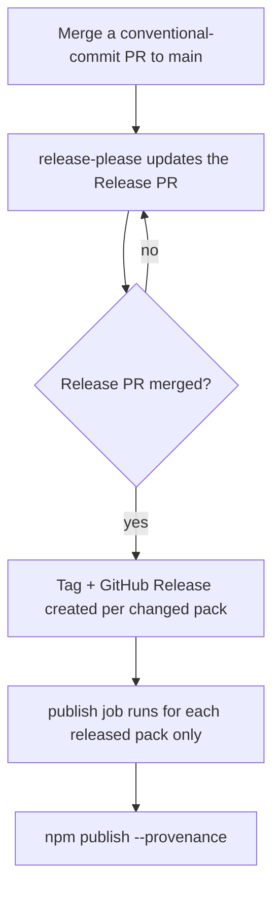

# Releasing

Every pack publishes to public npm from this repo via GitHub Actions using [npm Trusted Publishing (OIDC)](https://docs.npmjs.com/trusted-publishers) — no long-lived npm token. Versioning, changelogs, tags, GitHub Releases, and publishing are all automated by [release-please](https://github.com/googleapis/release-please).

You don't bump versions or cut releases by hand. You write [Conventional Commits](https://www.conventionalcommits.org/); release-please does the rest.

## How a release happens



1. **You merge a normal PR** to `main` with a conventional-commit title (`feat:`, `fix:`, etc.).
2. **release-please maintains a single open “Release PR”** that accumulates every pending change, bumps each affected pack's `version`, and updates that pack's `CHANGELOG.md`. Packs you didn't touch are untouched.
3. **When you merge the Release PR**, release-please creates a Git tag and GitHub Release for each bumped pack (e.g. `bluetemberg-rules-git-v0.2.0`).
4. **The publish job publishes only the packs that were just released** — not all 41 — each with a signed provenance statement.

## Versioning

Each pack carries its own `version` and is released independently. release-please derives the bump from your commit types:

| Commit type | Bump | Example |
| ----------- | ---- | ------- |
| `feat:` | minor | Adding/removing a rule — new behavior for consumers |
| `fix:` / `docs:` | patch | Editing rule wording |
| `feat!:` or `BREAKING CHANGE:` | major | A breaking restructure |

Scope the commit so release-please attributes it to the right pack — touch files under that pack's `packages/<name>/` directory in the same PR.

## Why only changed packs publish

`npm publish --workspaces` would attempt to publish all 41 packs on every release and **fail with `403` on every already-published version**. release-please reports exactly which paths it released (`paths_released`), and the publish job runs once per released path — the only correct shape for an incremental monorepo. This lives in `.github/workflows/release-please.yml`:

```yaml
strategy:
  matrix:
    path: ${{ fromJSON(needs.release-please.outputs.paths_released) }}
steps:
  - run: npm install -g npm@latest         # Trusted Publishing needs npm >= 11.5.1
  - run: npm ci
  - run: npm publish -w "$PKG_PATH" --provenance --access public
```

## Trusted publishers

Every pack that exists on npm has a trusted publisher pointing at this repo (`prototypdigital/bluetemberg-packs`) and the workflow file **`release-please.yml`**. That is the only way releases authenticate; there is no publish token.

Trusted Publishing can only publish over a package that already exists, so a brand-new pack is created by staging instead (below).

## Adding a new pack

1. Add the pack under `packages/` (see [Contributing](Contributing) for the layout) and register it with release-please:
   - add `"packages/<name>": {}` to `release-please-config.json`
   - add `"packages/<name>": "0.1.0"` to `.release-please-manifest.json`
2. **Merge.** `.github/workflows/stage-new-packs.yml` runs on any merge that touches a `packages/*/package.json`, finds packs missing from npm, and runs `npm stage publish` for each with the stage-only token. npm creates the package with a public `0.0.0-stage` placeholder and holds the real first version in the staged queue.
3. **A maintainer approves the first version** with 2FA, on npmjs.com (package → **Staged Packages** → **Approve**) or from the CLI:

   ```bash
   npm stage list <name>
   npm stage approve <stage-id>
   ```

4. **The maintainer adds the trusted publisher** (needs npm ≥ 11.15.0 and 2FA):

   ```bash
   npm trust github <name> --repo prototypdigital/bluetemberg-packs --file release-please.yml --allow-publish --yes
   ```

   A new trusted-publisher configuration **expires if it doesn't complete a publish within 2 days**. Run this step shortly before merging the Release PR that releases the pack. If it expired, `npm trust list <name>`, `npm trust revoke <name> --id=<id>`, and add it again.

Steps 3 and 4 can't be automated: npm requires an interactive 2FA challenge for approving staged versions and for changing trusted-publisher configuration, and no token can bypass it.

### Stage-only token

The repository secret **`NPM_STAGE_TOKEN`** is an npm granular access token with the **"Read and write (stage only)"** permission, created by a maintainer with 2FA enabled. It can't publish directly: npm rejects `npm publish` with it, so a leaked token can only queue versions that still need a maintainer's approval. It can still move dist-tags and deprecate versions, so treat it as a write secret.

Granular write tokens expire. When you create or rotate it, note the expiry date and replace it before then:

```bash
gh secret set NPM_STAGE_TOKEN --repo prototypdigital/bluetemberg-packs
```

The old `NPM_TOKEN` secret (a bypass-2FA publish token) is no longer used by any workflow. npm removes direct publishing from bypass-2FA tokens in January 2027; revoke it on npmjs.com and delete the secret.

## Claude marketplace sync

`.github/workflows/sync-marketplace.yml` runs on every merge to `main` that touches `packages/**` or `bluetemberg.config.json`, and can also be started by hand (`workflow_dispatch`). It runs `bluetemberg sync` and pushes the generated `plugins/` and `.claude-plugin/` to the marketplace repo named by the `MARKETPLACE_REPO` repository variable (`prototypdigital/claude-marketplace`). It skips the push when sync produced no output or nothing changed.

The push authenticates over SSH with a **deploy key**, not a personal access token, so it can't silently expire:

- The repository secret **`MARKETPLACE_DEPLOY_KEY`** in this repo holds the private ed25519 key.
- Its public half is a **write-enabled deploy key** on the marketplace repo.

When a sync run fails, a `report` job opens an issue labelled `marketplace-sync-failure` (or comments on the open one). The first green run closes it.

### Setting up or rotating the deploy key

Run these as a repo owner. Rotating is the same steps; remove the old deploy key from the marketplace repo afterwards.

```bash
ssh-keygen -t ed25519 -N "" -C packs-marketplace-sync -f marketplace_deploy_key
```

```bash
gh repo deploy-key add marketplace_deploy_key.pub --repo prototypdigital/claude-marketplace --allow-write --title "packs marketplace sync"
```

```bash
gh secret set MARKETPLACE_DEPLOY_KEY --repo prototypdigital/bluetemberg-packs < marketplace_deploy_key
```

```bash
rm marketplace_deploy_key marketplace_deploy_key.pub
```

Then start the workflow by hand (Actions → Sync Claude Marketplace → Run workflow) to confirm the push works.

## Wiki

This wiki is generated from `docs/wiki/*.md` in the repo. `.github/workflows/sync-wiki.yml` pushes any change under `docs/wiki/` to the GitHub Wiki on merge to `main` — edit the Markdown here, not the wiki directly.
